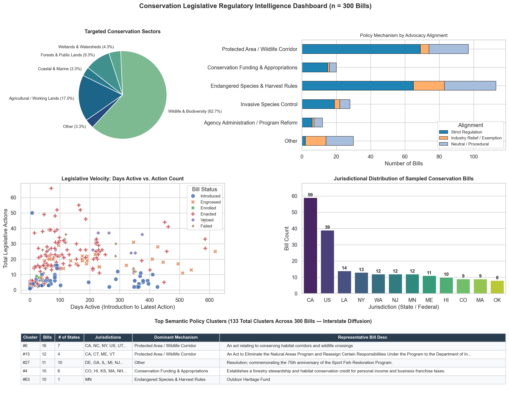

# Conservation Legislative Regulatory Intelligence Pipeline

An end-to-end legislative intelligence pipeline that ingests U.S. state and federal conservation, wildlife, and habitat bills via the **LegiScan API**, groups related legislation using dense semantic embeddings (**SentenceTransformers** + **Agglomerative Clustering**), extracts structured regulatory metadata locally via **Ollama (`llama3.1`)** with **Pydantic** schema enforcement, and generates an executive analytics dashboard.

## Architecture & Pipeline Flow

1. **Ingestion (`getSearchRaw` & `getBill`)**: Queries LegiScan for conservation/wildlife legislation, extracts bill metadata and action histories, and computes legislative velocity (`days_active` and `action_count`) across status stages (`1: Introduced` through `6: Failed`).
2. **Semantic Clustering (`SentenceTransformers`)**: Encodes bill titles and descriptions with `all-MiniLM-L6-v2` and applies cosine-distance agglomerative clustering to surface cross-state policy diffusion, companion bills, and recurring appropriations cycles.
3. **Structured LLM Classification (`Ollama` + `Pydantic`)**: Runs a local `llama3.1` model with `temperature=0.1`, repetition penalties, output token caps, and `Pydantic` validation to classify `policy_mechanism`, `target_sector`, `advocacy_alignment`, and a plain-English summary, with safe fallback handling.
4. **Visualization & Export**: Outputs both a structured dataset (`cons_legislative_intelligence.csv`) and a multi-panel executive dashboard (`conservation_legislative_dashboard.png`) covering sector share, policy mechanism by alignment, legislative velocity, top jurisdictions, and top semantic clusters.

## Iterative Taxonomy Refinement

Early prototyping and error analysis highlighted how broad or catch-all categories can obscure specific legislative intent:
* **Taxonomy & Schema Hardening**: Iterated on `policy_mechanism`, `target_sector`, and `advocacy_alignment` categories while enforcing strict `Literal` schema constraints and fallback safeguards so edge-case or terse bill descriptions don't break runs or flood `"Other"`.
* **Cross-Bill Context**: Pairing semantic clusters with structured LLM fields makes it easier to spot recurring model legislation across states versus single-jurisdiction funding bills.

## Local Setup & Usage

### Prerequisites
* Python 3.10+
* [Ollama](https://ollama.com/) installed and running locally (`http://127.0.0.1:11434`) with `llama3.1` pulled (`ollama pull llama3.1`)
* A [LegiScan API](https://legiscan.com/legiscan) key

## Local LLM Setup (Ollama)

This pipeline uses [Ollama](https://ollama.com) for local model inference so data stays on your machine with no external API keys required.

### 1. Install Ollama
* **Linux / WSL2:**
  ```bash
  curl -fsSL [https://ollama.com/install.sh](https://ollama.com/install.sh) | sh
  ```
* **Windows / macOS:** Download and install from [ollama.com/download](https://ollama.com/download).

### 2. Pull the Required Model
Once the Ollama service/app is running, pull the model configured for the pipeline:
```bash
ollama pull <your-model-name>
```
*(Optional)* If migrating from another machine, copy the `models/` directory (`~/.ollama/models` or `/usr/share/ollama/.ollama/models` on Linux; `%USERPROFILE%\.ollama\models` on Windows) while Ollama is stopped, then run `ollama list` to verify.

### 3. Run the Model
```bash
ollama run <your-model-name> "Reply with OK"
```

### 4. Verify GPU Acceleration (Optional)
With a model loaded, check that layers are offloaded to your GPU rather than running 100% on CPU:
```bash
ollama ps
```

### 5. Environment Variables
You can override defaults using environment variables before running `pipeline.py`:

| Variable | Default | Description |
| :--- | :--- | :--- |
| `OLLAMA_HOST` | `http://localhost:11434` | Ollama server URL (useful if running on another host/port) |
| `OLLAMA_MODEL` | `<default-model>` | Model tag to use for inference |
| `OLLAMA_TIMEOUT` | `60` | Request timeout in seconds |

### Installation

```bash
pip install -r requirements.txt
```

### Environment Variables

Set your LegiScan API key as an environment variable before running the pipeline:

CMD:
```bash
set LEGISCAN_API_KEY=your_legiscan_api_key_here
```
Bash:
```bash
export LEGISCAN_API_KEY="your_legiscan_api_key_here"
```
PS:
```bash
$env:LEGISCAN_API_KEY="your_legiscan_api_key_here"
```

Optional: Set a HuggingFace Token to silence some errors. Name does not matter.
```bash
set HF_TOKEN=your_token_here
```

### Run the Pipeline

```bash
python pipeline.py
```

## Outputs

* `cons_legislative_intelligence.csv`: Bill metadata, legislative status and velocity metrics, semantic cluster IDs, and structured LLM classifications.
* `conservation_legislative_dashboard.png`: Summary dashboard combining conservation sector distribution, policy mechanism by alignment, legislative velocity, top jurisdictions, and top semantic policy clusters.